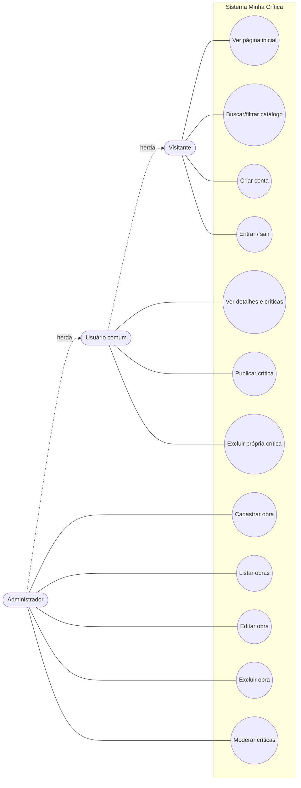

# Casos de uso — Minha Crítica

Diagrama visual: [`diagrama-casos-de-uso.svg`](diagrama-casos-de-uso.svg)

## Atores

- **Visitante** — qualquer pessoa sem login.
- **Usuário comum** (`ROLE_USER`) — herda tudo do Visitante.
- **Administrador** (`ROLE_ADMIN`) — herda tudo do Usuário comum.

## Lista de casos de uso

| ID | Caso de uso | Visitante | Usuário | Admin |
|---|---|:-:|:-:|:-:|
| UC01 | Ver página inicial | ✔ | ✔ | ✔ |
| UC02 | Buscar e filtrar o catálogo | ✔ | ✔ | ✔ |
| UC03 | Criar conta | ✔ | | |
| UC04 | Entrar / sair | ✔ | ✔ | ✔ |
| UC05 | Ver detalhes e críticas da obra | | ✔ | ✔ |
| UC06 | Publicar crítica | | ✔ | ✔ |
| UC07 | Excluir a própria crítica | | ✔ | ✔ |
| UC08 | Cadastrar obra | | | ✔ |
| UC09 | Listar obras (painel admin) | | | ✔ |
| UC10 | Editar obra | | | ✔ |
| UC11 | Excluir obra | | | ✔ |
| UC12 | Moderar (excluir) crítica de qualquer usuário | | | ✔ |

## Diagrama em texto (Mermaid)

## Fluxos principais

### UC06 — Publicar crítica
1. O usuário logado abre a página de uma obra.
2. Escolhe uma nota de 1 a 5 e escreve o comentário.
3. O sistema valida os dados (RN03) e verifica se ele já criticou esta obra.
4. A crítica é salva, a média é recalculada (RN06) e uma mensagem de sucesso é exibida.

**Fluxo alternativo:** dados inválidos → o formulário volta com as mensagens de erro ligadas a cada campo.
**Exceção:** o usuário já avaliou a obra → mensagem “Você já publicou uma crítica para esta obra”.

### UC08 — Cadastrar obra (CRUD: Create)
1. O administrador acessa **Gerenciar obras → Nova obra**.
2. Preenche título, tipo, gênero, ano, autor/direção e sinopse.
3. O sistema valida (RN07, RN09) e salva.
4. Volta para a listagem com mensagem de sucesso.

### UC10 — Editar obra (CRUD: Update)
1. Na listagem, o administrador clica em **Editar**.
2. O formulário abre preenchido; ele altera os campos e salva.
3. O sistema valida e atualiza.

### UC11 — Excluir obra (CRUD: Delete)
1. Na listagem, o administrador clica em **Excluir**.
2. Uma página de confirmação mostra a obra e quantas críticas serão apagadas.
3. Ao confirmar, a obra e suas críticas são removidas (RN05).
